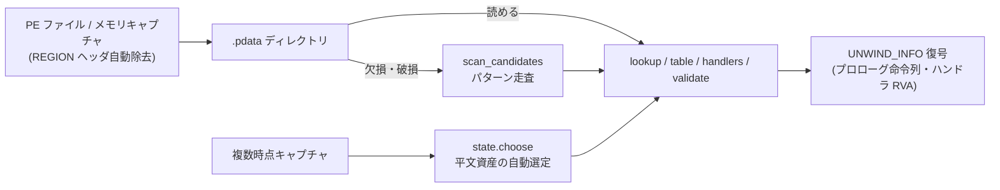

# sekka(雪華)— x64 PE 例外テーブル(.pdata)静的解析ツールキット

**sekka**は、64ビットPEイメージの例外テーブル(`.pdata` / `RUNTIME_FUNCTION`)とアンワインド情報(`UNWIND_INFO`)を静的に解析するPythonツールキットです。実行せず、ファイル(またはメモリダンプ)から例外処理のメタデータを読み、次のような問いに答えます。

- このアドレスはどの関数に属するのか(例外ハンドラ表引き)
- ある関数領域にアンワインド情報は存在するか
- 解析結果は実測値と一致するか(正例突合による回帰チェック)

雪華は「雪の結晶」の意。x86-64のアンワインド情報は、関数の境界を結晶のように規則正しく記録する静的構造です。

## 背景: x64の例外処理はなぜ表駆動か

x86-64のWindows ABIでは、関数プロローグでスタックフレームポインタ(RBP)を
省略するのが既定です。実行時のスタック巻き戻しはフレームポインタ連鎖に頼らず、
`.pdata`セクションの`RUNTIME_FUNCTION`三つ組(begin / end / unwind RVA)と、
`UNWIND_INFO`が記録したプロローグ操作の再生によって行われます。

つまり`.pdata`は:

- 例外の配送のための表でありながら、**実質的に「関数境界の公式な目録」**
  でもある(シンボルが無くても関数表が手に入る)
- クラッシュダンプからスタックを巻き戻すポストモーテム解析の必須データ
  (Breakpad / Crashpadのwalkbackと同じ情報源)
- ストリップや難読化の後処理で壊れやすい部分
  (例外ディレクトリが壊れたPEは、Windows上でも例外発生時に即死する)

という、低レベルツールにとって一級の情報源です。sekkaはこの表を静的に読む道具です。

## 特徴

- **純Python・サードパーティ依存ゼロ**で動作(NumPyは後述の任意依存)
- `.pdata`ディレクトリが壊れている・欠けているイメージでも、**パターン走査で`RUNTIME_FUNCTION`候補を発掘**
- メモリキャプチャにも対応:採取ツールが先頭に付ける`REGION`系テキストヘッダを自動除去
- **複数時点キャプチャの自動選択**:同じRVAを複数ダンプで比較し、平文らしい資産から優先的に表引き
- Python API(ライブラリ)とCLI(コマンド)の両面で使える

非破壊・非実行の静的解析ツールです。想定する具体的な用途:

- **ポストモーテム解析** — クラッシュダンプのスタック巻き戻しに必要な
  関数表とハンドラ配置を、実行前に把握しておく
- **サンプリングプロファイラ** — シンボル無しバイナリの関数境界抽出
  (`.pdata`は無料の関数表)
- **OS互換層(ReactOS等)開発** — 例外ディスパッチ実装との突合・
  不整合原因の切り分け
- **CI lint** — ストリップ・難読化・リロケーション等の後処理を通した
  バイナリの例外ディレクトリ健全性の機械検査

## 想定ワークフロー



## インストール

```console
pip install sekka
```

NumPyによる高速化を有効にする場合:

```console
pip install sekka[fast]
```

ソースから:

```console
git clone https://github.com/sh-sunfaded/Sekka.git
cd Sekka
pip install .          # コアのみ
pip install .[fast]    # + NumPy 高速パス
```

`pip install`済みなら`sekka`コマンドが、ソースツリーからは`python3 -m sekka.cli`でも動作します。

## コマンド

| コマンド | 内容 |
|---|---|
| `lookup` | アドレスから関数範囲・アンワインド情報・言語ハンドラを検索(複数イメージ対応・`--scan`で走査fallback) |
| `table` | `.pdata`ディレクトリの全エントリを一覧(`--start`/`--end`/`--limit`/`--json`) |
| `handlers` | 言語ハンドラを持つ関数を一覧(`--json`) |
| `validate` | RVAとハンドラRVAの正例突合(実測値の回帰チェック用・exit 0/1) |

共通フラグ `--version` でバージョンを表示します。

### lookup: アドレスから関数表引き

```console
$ sekka lookup app.exe --rva 0x10020
image: app.exe
function: begin rva 0x10000 (VA 0x140001000)  end rva 0x10080 (VA 0x140001080)
unwind: rva 0x20000 (VA 0x140020000)
unwind info: version 1  flags EHANDLER  prolog 0x3  codes 1
  [0] push rbp
language handler: rva 0xBEEF (VA 0x14000BEEF)
```

`.pdata`ディレクトリが読めない・壊れているイメージでは`--scan`を付けると、
イメージ全体をパターン走査して該当エントリを探します:

```console
$ sekka lookup corrupt.bin --scan --rva 0x10020
```

**複数イメージ指定**(ダンプ時点による平文/暗文の入れ替わり対策):
同じRVAを複数のキャプチャで比較し、平文らしい資産から順に表引きします:

```console
$ sekka lookup dump_before.bin dump_after.bin --rva 0x1400
captures at rva 0x1400 (plain-like first):
  dump_after.bin           entropy=0.000 zero=0.0000 plain-like
  dump_before.bin          entropy=7.956 zero=0.0032 cipher-like

image: dump_after.bin
function: begin rva 0x1400 (VA 0x140001400)  end rva 0x1500 (VA 0x140001500)
...
```

同名のファイル(異なるディレクトリの`dump.bin`など)は`dump.bin #2`のように
付番して区別します。`--json`は機械可読形式で出力します(数値は10進):

```console
$ sekka lookup app.exe --rva 0x10020 --json
[
  {
    "image": "app.exe",
    "function": {
      "begin_rva": 65536,
      "end_rva": 65664,
      "unwind_rva": 131072
    },
    "unwind": {
      "version": 1,
      "flag_names": ["EHANDLER"],
      "handler_rva": 48879,
      ...
    }
  }
]
```

### table: 例外テーブル一覧

```console
$ sekka table app.exe
0x001400-0x001500  (VA 0x140001400-0x140001500)  unwind 0x2000
0x001500-0x001600  (VA 0x140001500-0x140001600)  unwind 0x2024
0x001600-0x001700  (VA 0x140001600-0x140001700)  unwind 0x200C
0x001800-0x001900  (VA 0x140001800-0x140001900)  unwind 0x2014
total: 4 entries
```

### handlers: 例外ハンドラ表

```console
$ sekka handlers app.exe
function 0x001400-0x001500  handler rva 0x00BEEF (VA 0x14000BEEF)  [EHANDLER]
function 0x001500-0x001600  handler rva 0x005678 (VA 0x140005678)  [EHANDLER]
function 0x001600-0x001700  handler rva 0x001234 (VA 0x140001234)  [UHANDLER]
total: 3 entries with a language handler
```

### validate: 正例突合

既知の「RVA → ハンドラRVA」の実測ペアと突き合わせ、解析結果の回帰チェックに使います(exit 0/1):

```console
$ sekka validate app.exe --rva 0x1400 --handler 0xBEEF
PASS: function 0x1400-0x1500 handler rva 0xBEEF (VA 0x14000BEEF)
$ sekka validate app.exe --rva 0x1400 --handler 0x1234
FAIL: expected handler 0x1234, found 0xBEEF
$ sekka validate app.exe --rva 0x99999 --handler 0xBEEF
FAIL: no RUNTIME_FUNCTION covers rva 0x99999
```

## Python API

```python
from sekka import pe, pdata, state

img = pe.load(open("app.exe", "rb").read())
entries = pdata.load_entries(img)               # 例外テーブル読み込み
fn = pdata.lookup(img, 0x10020)                # 表引き -> RuntimeFunction
cands = pdata.scan_candidates(img, 0x10020)    # 走査による候補発掘

# 複数時点キャプチャから平文らしい資産を選ぶ
best = state.choose({"before": img, "after": img2}, 0x10020)
```

`pe.load()`は、オンディスクのPE(`.exe`/`.dll`)と、先頭に`REGION:`行が付いたメモリキャプチャ形式の両方を受け付けます。

## 入力形式

- 通常のPEファイル(MZ/PEヘッダ + `.pdata`ディレクトリ)
- メモリキャプチャ(`REGION: <start> <size>`ヘッダ + 生ダンプ)は自動判別し、ヘッダ行を取り除いて処理します

## パフォーマンス(任意依存: NumPy)

`sekka[fast]`を導入すると、以下の処理がNumPyでベクトル化されます。未導入でも純Python実装が同じ結果を返します(ドロップイン置換)。

| 処理 | 高速化手法 |
|---|---|
| エントロピ計算・ゼロ比率 | `np.frombuffer` + `bincount`一括集計 |
| 例外テーブル読み込み | `frombuffer`で(N,3)行列化 → 無効エントリをマスク一括除外 |
| パターン走査候補抽出 | u4ビュー + スライス3枚で全オフセットを一括マスク → `flatnonzero`で列挙 |

走査ヒット後の個々の候補検証(`UNWIND_INFO`解読、RVA→オフセット変換、関数範囲の上限判定)はデータ依存の分岐が多く、ベクトル化せず純Pythonのまま検証します。ハンドラ表引きは二分探索(O(log n))で、検索本数が多くない限り十分高速です。

## モジュール

| モジュール | 役割 |
|---|---|
| `sekka/pe.py` | PEローダ(ヘッダ解析・セクション・RVA⇔オフセット変換) |
| `sekka/pdata.py` | 例外テーブルの読み込み・表引き・走査 |
| `sekka/unwind.py` | UNWIND_INFOの解析(プロローグ命令列の復号) |
| `sekka/state.py` | 複数キャプチャの統計的評価(エントロピー・ゼロ比率による平文選定) |
| `sekka/fastpath.py` | NumPy実装(HAVE_NUMPYで自動切替、未導入なら純実装にfallback) |
| `sekka/cli.py` | コマンドラインフロントエンド |

## 関連ツール

同じメモリフォレンジックの流れで併用できる姉妹ツール:

- [izayoi](https://github.com/sh-sunfaded/izayoi) — 複数時点ダンプの比較・トリアージ(どこが・いつ変わるかの特定)
- [Toka](https://github.com/sh-sunfaded/Toka) — パッカー/VMで保護されたブロックの復号・展開

## テスト

```console
$ python3 tests/test_sekka.py
```

合成PEイメージを動的に組み立てるため、外部フィクスチャは不要です。NumPyが導入された環境では高速実装と純実装の**等価性テスト**が自動的に走ります(未導入ではskip)。

## 制限

- x86-64のみ(chained unwind info は平坦化して扱います)
- 例外ディレクトリ破損時の走査はヒューリスティックであり、擬陽性(データ中の偶然の一致)を含みます
- 静的解析のみ。実行時の例外動作の再現は行いません

## ライセンス

Apache-2.0
